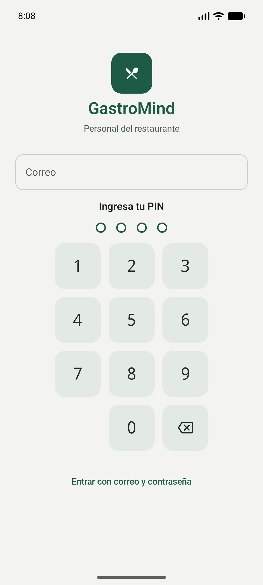
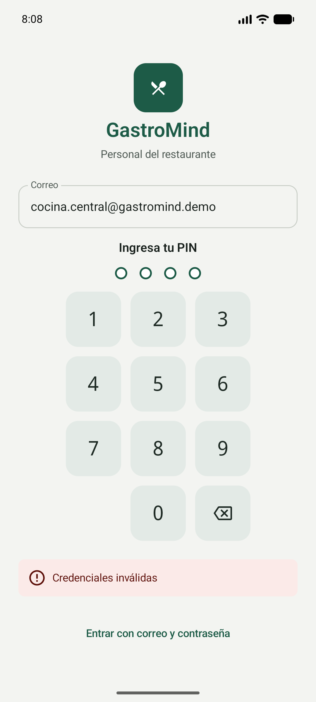
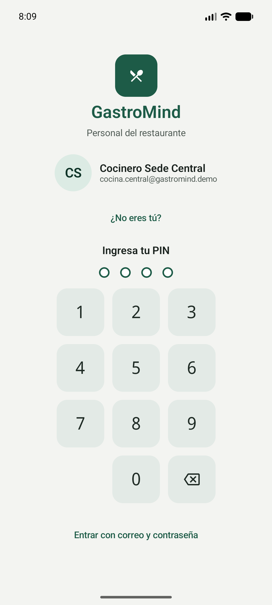
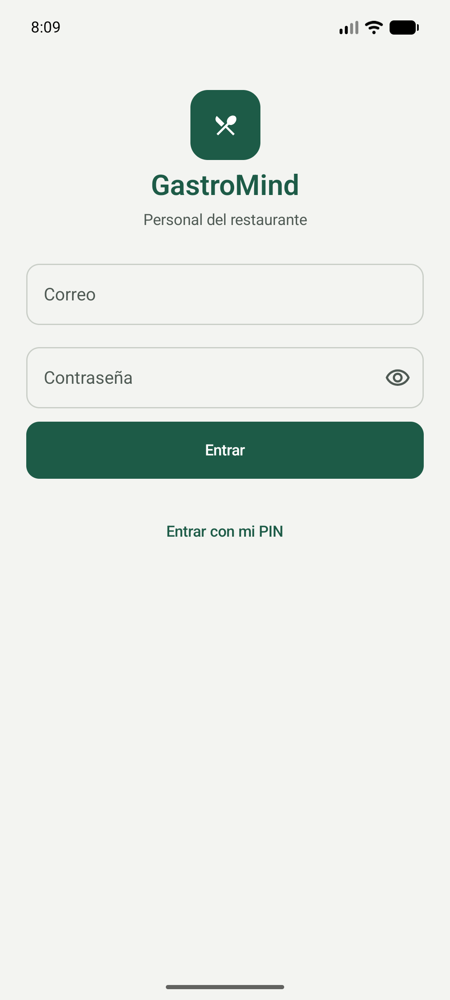
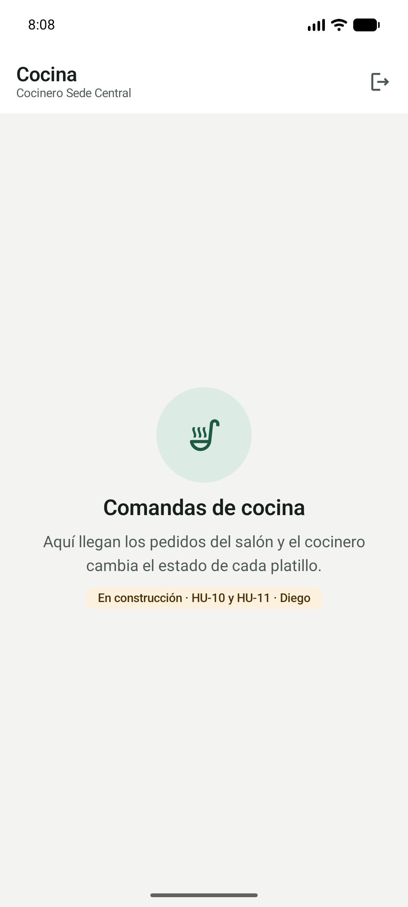
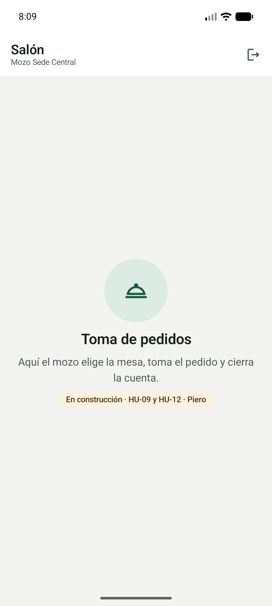

# GastroMind — App móvil (Kotlin / Android)

Módulo **operativo** de GastroMind para el personal del restaurante: mozo, cocinero y almacenero.
Curso: *Programación en Móviles (Kotlin)*.

> Backend y web: [GastroMind-SpringBoot](https://github.com/diegoz-netizen/GastroMind-SpringBoot) · catálogo y reportes: [GastroMind-Django](https://github.com/diegoz-netizen/GastroMind-Django)

## Arquitectura

```
App Android (este repo) ──▶ Spring Boot (login, pedidos, stock) ──▶ PostgreSQL
                       └──▶ Django (kardex HU-15, con el mismo JWT)
```

La app **no** se conecta directo a la base de datos: todo pasa por la API.

**MVVM, como en el curso (Lab 08):**

```
com.gastromind.app/
├── GastroMindApp.kt          crea el AppContainer
├── di/AppContainer.kt        inyección manual (sin Hilt): Retrofit, OkHttp, sesión, repositorios
├── data/
│   ├── remote/               GastroMindApi (Retrofit), DTOs, AuthInterceptor (JWT), mensajes de error
│   ├── session/              SesionStore (DataStore): token, rol y el último empleado
│   └── repository/           AuthRepository (interface) + AuthRepositoryImpl, Resultado
└── ui/
    ├── theme/                colores, tipografía, formas y medidas (única fuente del diseño)
    ├── components/           botones, campos, teclado del PIN, barra superior, estados
    ├── navigation/           GastroMindNavHost: la sesión decide la pantalla
    ├── login/                LoginScreen + LoginViewModel + LoginUiState (HU-02 y HU-27)
    └── rol/                  inicio de cada rol (lo reemplaza cada HU)
```

- Las pantallas solo dibujan un `StateFlow<UiState>` y mandan eventos al ViewModel. Nunca llaman a la API.
- El ViewModel habla con el repositorio, que devuelve `Resultado.Exito` o `Resultado.Error(mensaje)`.
- **La sesión manda la navegación:** al entrar, el repositorio guarda la sesión y `GastroMindNavHost` lleva al inicio del rol. Cerrar sesión o un **401** (token vencido o empleado desactivado, HU-03) vuelven al login.
- Room no va en la base: se suma solo si una HU pide trabajar sin conexión.

## Qué hay en la base (28/10)

| Pantalla | HU | Estado |
|---|---|---|
| Ingreso con correo y PIN de 4 dígitos | HU-27 | ✅ El último empleado queda recordado: la próxima vez solo se pide el PIN |
| Ingreso con correo y contraseña | HU-02 | ✅ |
| Inicio del mozo (Salón) | HU-09, HU-12 · Piero | Pantalla vacía para empezar |
| Inicio de cocina | HU-10, HU-11 · Diego | Pantalla vacía para empezar |
| Inicio del almacén | HU-14, HU-15 · Victor | Pantalla vacía para empezar |
| Administrador | — | "Usa la web" (la app es para el personal operativo) |

| Login con PIN | PIN incorrecto | Empleado recordado | Correo y contraseña | Cocina | Salón |
|---|---|---|---|---|---|
|  |  |  |  |  |  |

## Cómo se ejecuta

1. Spring corriendo en la PC (`http://localhost:8080`) con la BD del seed. El ingreso con PIN necesita el endpoint `POST /api/auth/login-pin` (Spring, rama `feature/HU-27-login-pin`).
2. Abrir este proyecto en Android Studio y ejecutar en el emulador.
   - **URL de la API:** por defecto `http://10.0.2.2:8080/` (la PC vista desde el emulador). Se cambia con `gastromind.apiUrl=…` en `local.properties` (no se sube).
   - Si el emulador no llega a `10.0.2.2` (pasó en Windows), usar el puerto de la PC con `adb reverse tcp:8080 tcp:8080` y `gastromind.apiUrl=http://localhost:8080/`.
   - **Tablet real (cocina):** `gastromind.apiUrl=http://<IP de la PC>:8080/`, en la misma red.
3. Cuentas demo (`docs/seed_demo.sql` del repo Spring): `cocina.central@gastromind.demo`, `mozo.central@gastromind.demo`, `almacen.central@gastromind.demo` con PIN **1234** o contraseña `Demo2026!`.

Por línea de comandos (con el JDK de Android Studio):

```bash
./gradlew :app:testDebugUnitTest :app:assembleDebug
```

## Sistema de diseño

Sale del **prototipo final** del equipo (Figma, 27/10). Está todo en `ui/theme` y `ui/components`; las pantallas no usan colores, tamaños ni formas a mano.

| Decisión | Valor |
|---|---|
| Personalidad | Herramienta de trabajo: sobria, legible de lejos, botones grandes (se usa con prisa y a veces con guantes) |
| Color principal | Verde cocina `#1D5B47`, contenedor `#DCEBE4` |
| Fondo y superficies | Papel claro `#F3F4F1` y blanco; texto `#18201C` |
| Avisos | Ámbar `#C98A1E` / `#FBF1DE` (estados, "en construcción") · error `#B42318` / `#FBEAE8` |
| Formas | Esquinas sutiles: 8 / 12 / 16 dp |
| Tipografía | Fuente del sistema; **cifras en monoespaciada** (PIN, cantidades, montos), como el prototipo |
| Imágenes | Íconos del dominio por rol; el personal se muestra con sus iniciales (no hay fotos) |
| Tema | Solo claro y sin color dinámico. El KDS oscuro del prototipo se suma con la HU-10 |

En las pantallas: `MaterialTheme.colorScheme.*`, `MaterialTheme.typography.*`, `MaterialTheme.shapes.*` y `Dimens.*`. Si dos pantallas dibujan lo mismo, va a `ui/components`.

## Cómo sumar tu HU

1. Rama desde `main`: `feature/HU-xx-...`.
2. Endpoints en `data/remote/GastroMindApi.kt` y DTOs en `data/remote/dto/`.
3. Un repositorio (interface + implementación) en `data/repository/`, creado en `AppContainer`.
4. Pantalla en `ui/<rol>/`: `XxxRoute` (conecta el ViewModel) + `XxxScreen` (solo estado) + `XxxViewModel` + `XxxUiState`.
5. Ruta en `ui/navigation/GastroMindNavHost.kt` y reemplazar el inicio vacío de tu rol.
6. Test del ViewModel con un repositorio falso (ver `LoginViewModelTest`).

## Reglas

1. **Login único:** Spring emite el JWT (`/api/auth/login` o `/api/auth/login-pin`) y va en cada petición como `Authorization: Bearer <token>`, lo pone `AuthInterceptor`.
2. La sesión se guarda en DataStore. **Nunca** se guarda la contraseña ni el PIN; el log de red (solo en debug) no muestra los cuerpos.
3. La URL de la API va en configuración (`local.properties`), no en el código. `http` sin cifrar solo se permite en debug.

## Flujo de trabajo

Igual que en los otros repos: una rama por tarea, Pull Request a `main` con 1 aprobación de otro integrante. `main` está protegida.

## Equipo

Diego Panez · Victor Santamaría · Piero Guevara
